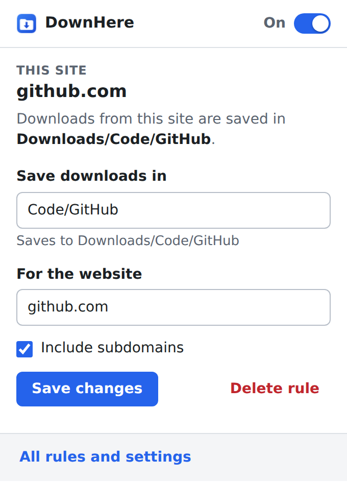
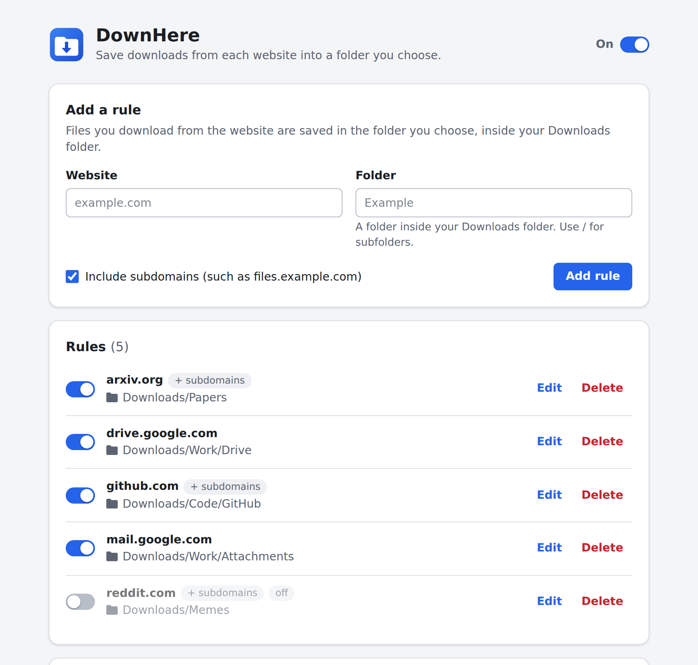

# DownHere

**Choose which folder downloads are saved to, for each website.**

DownHere is a Chrome extension that sorts your downloads as they happen. Tell it that files from `github.com` belong in
`Downloads/Code/GitHub` and that invoices from your bank belong in `Downloads/Money/Invoices`, and every download from
those sites lands in the right folder without a Save As dialog.

<p align="center">
  
</p>

## Features

- **A folder for each website.** Rules like `github.com → Code/GitHub`, including nested folders, which are created
  automatically.
- **Set up in seconds.** Open a site, click the DownHere button, type a folder name, save.
- **Subdomains included if you want them.** One rule for `google.com` can cover `drive.google.com` and
  `mail.google.com`, or you can give each its own folder. The most specific rule always wins.
- **Understands where a download really comes from.** Rules match the page you downloaded from as well as the file’s
  own address, before and after redirects (for example, GitHub release files are served from another domain).
- **Your choice when a name is taken.** Keep both files, replace the old one, or be asked.
- **Switch rules off** without deleting them, or pause DownHere entirely.
- **Check before you download.** Paste an address to see which folder it would go to.
- **Back up and restore** your rules and settings as a file.
- **Private.** No accounts, no tracking, no network requests. Light and dark mode.



## Install

DownHere isn’t in the Chrome Web Store yet. To install it from this repository:

1. Download this repository (green **Code** button › **Download ZIP**) and unzip it, or clone it with Git.
2. Open `chrome://extensions` in Chrome.
3. Switch on **Developer mode** (top-right corner).
4. Click **Load unpacked** and select the `extension` folder inside the repository.
5. Optional: open the puzzle-piece **Extensions** menu next to the address bar and pin DownHere so its button is
   always visible.

DownHere needs Chrome 120 or newer. Other Chromium-based browsers may work too, but haven’t been tested.

## How to use it

**From the toolbar:** open any website, click the DownHere button, type a folder name and click **Save**. From then on,
files you download from that site are saved in that folder inside your Downloads folder. Use `/` for subfolders, for
example `Work/Invoices`.

**On the settings page** (right-click the DownHere button and choose **Options**, or click **All rules and settings**
in the popup) you can add, edit, switch off and delete rules, change settings, check where a download will go, and back
up your rules.

## How rules are matched

- A rule for `example.com` covers `example.com` and `www.example.com`. With **Include subdomains** switched on it also
  covers addresses such as `files.example.com`. You can type or paste a full address; DownHere keeps only the domain.
  Typing `*.example.com` switches on subdomains for you.
- Every download has two addresses: the **page** you were on and the **file’s own address**. DownHere checks the page
  first, then the file’s address before and after any redirects. The first address that has a rule decides the folder.
  In the settings you can make the file’s own address go first instead.
- When several rules fit an address, the most specific one wins: a rule for `docs.example.com` beats one for
  `example.com`.
- Rules that are switched off are skipped. Downloads that match no rule are saved wherever Chrome would normally put
  them.

| Rules | You download… | Saved in |
| --- | --- | --- |
| `github.com` → `Code/GitHub`, with subdomains | a release from a github.com page | `Downloads/Code/GitHub` |
| `google.com` → `Google`, with subdomains | an attachment in mail.google.com | `Downloads/Google` |
| `google.com` → `Google` and `drive.google.com` → `Work/Drive` | a file from drive.google.com | `Downloads/Work/Drive` |
| `reddit.com` → `Memes`, `imgur.com` → `Imgur` | an image stored on imgur.com, from a reddit.com page | `Downloads/Memes` (page first, the default) |

## Settings

- **If the folder already has a file with the same name:** keep both (Chrome adds a number such as `report (1).pdf`),
  replace the existing file, or ask where to save the new one.
- **If the page and the file match different rules:** use the rule for the page (default) or for the file’s own
  address.
- **Downloads started by other extensions:** DownHere sorts them too, unless you tell it to leave them where those
  extensions save them.
- **On / Paused:** the switch at the top of the popup and the settings page turns all rules on or off at once.

## Good to know

- Chrome only lets extensions save files inside your Downloads folder, the location set in Chrome’s
  **Settings › Downloads**. Your rule folders are created inside it. To use a different base folder, change that
  location in Chrome.
- DownHere only chooses the folder. Files keep the name Chrome gives them. In the rare case that Chrome doesn’t accept
  a file’s name inside a folder (such as `CON.txt`, which is reserved on Windows), the file is saved in the Downloads
  folder as usual.
- If Chrome is set to ask where to save each file, the save dialog suggests the rule’s folder.
- Files opened from your own computer (`file://` addresses) are never moved.
- Rules only apply in Incognito windows if you allow DownHere in Incognito
  (`chrome://extensions` › DownHere › **Details**).
- Only one extension can choose where a download is saved. If another extension does this too, Chrome follows the one
  that was installed or updated most recently.
- On Linux, folder and file names with non-English characters need a UTF-8 system locale (the default on current
  distributions); otherwise Chrome saves those files in the Downloads folder.

## Privacy and permissions

DownHere doesn’t collect, send or share any data. Your rules and settings are stored only in your browser
(`chrome.storage.local`), and the extension contains no code that talks to the network.

| Permission | Why it’s needed |
| --- | --- |
| `downloads` | To choose the folder while Chrome is naming a download. Chrome shows this as “Manage your downloads”. |
| `storage` | To keep your rules and settings. |
| `activeTab` | To read the address of the current tab, only when you click the DownHere button, so the popup can fill in the website. |

## Development

The extension is plain JavaScript with no build step and no dependencies. [Node.js](https://nodejs.org/) 20 or newer
is only needed for the tests and for packaging.

```sh
npm test          # run the unit tests
npm run package   # create dist/downhere-<version>.zip
```

After changing files in `extension/`, click the reload button on DownHere’s card in `chrome://extensions`.

```text
extension/
  manifest.json      Extension manifest (Manifest V3)
  background.js      Service worker: picks the folder for each download
  lib/rules.js       Rule matching and Chrome's path rules (no browser APIs, unit tested)
  lib/storage.js     Reading and saving rules and settings
  lib/ui.js          Shared helpers for the popup and settings page
  popup/             Toolbar popup
  options/           Settings page
  styles/            Shared styles
  icons/             Extension icons
assets/icon.svg      Source of the icons
docs/screenshots/    Images used in this README
scripts/package.mjs  Builds the ZIP for the Chrome Web Store
tests/               Unit tests (Node's built-in test runner)
```

### Releasing a new version

1. Update `version` in both `extension/manifest.json` and `package.json`.
2. Describe the changes in [CHANGELOG.md](CHANGELOG.md).
3. Run `npm test` and `npm run package`.
4. Upload `dist/downhere-<version>.zip` in the Chrome Web Store Developer Dashboard, and/or create a GitHub release
   tagged `v<version>` with the ZIP attached.
